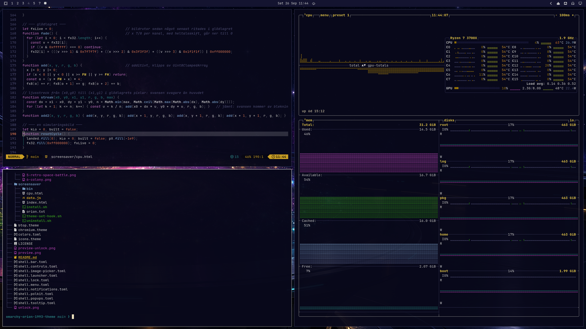

# Orion 1993

An [Omarchy](https://omarchy.org) theme in the spirit of the early-nineties 4X space games:
navy panels, bevelled steel frames and gold, with colors sampled from a 320×200 VGA palette.



## Install

```bash
omarchy theme install https://github.com/dennisp80/omarchy-orion-1993-theme
```

That gives you:

- colors sampled from the palette, for terminals, editors and the rest of the system
- bevelled steel window borders
- the bar, menus, launcher, notifications and dialogs as navy panels in steel frames, with the
  selected row in gold and red for anything asking for attention
- btop with steel boxes, the CPU in gold, memory in nebula magenta and network in cyan
- a navy Chromium frame and yellow icons (Yaru)
- six backgrounds, starting with the round strategy table (cycle them with Super + Ctrl + Space)
- the lock screen with the ORION emblem

For the boot splash as well (asks for your password):

```bash
omarchy plymouth set by theme orion-1993
```

## The screensaver (optional)

There is a matching screensaver: gold pixels assemble the ORION emblem, it explodes into a jump to
lightspeed, and ~310 000 glowing carriers fly back in and build a 3D strategy table with a living
galaxy on it. A theme may not ship code, so it lives in a repository of its own:
**[omarchy-orion-1993-screensaver](https://github.com/dennisp80/omarchy-orion-1993-screensaver)**
(try it in your browser first: <https://dennisp80.github.io/omarchy-orion-1993-screensaver/page/?test>).

Installed it from this theme's `screensaver/install.sh` before November 2026? After this update it falls
back to Omarchy's text effects; run `install.sh` from the new repository once to bring it back, or its
`uninstall.sh` to remove what the old install added.

## Credits

- The backgrounds and the ORION emblem were generated with an AI image model (OpenAI) and then
  remapped to the palette.
- Inspired by, and not affiliated with, the classic space strategy games of 1993.

## License

[MIT](LICENSE)
